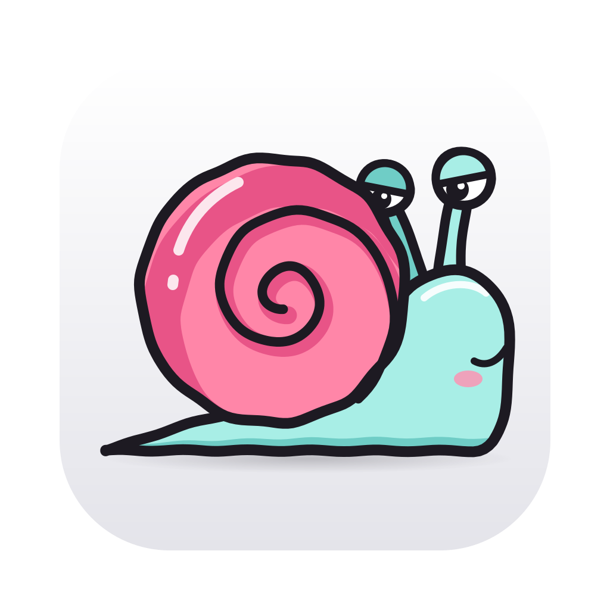
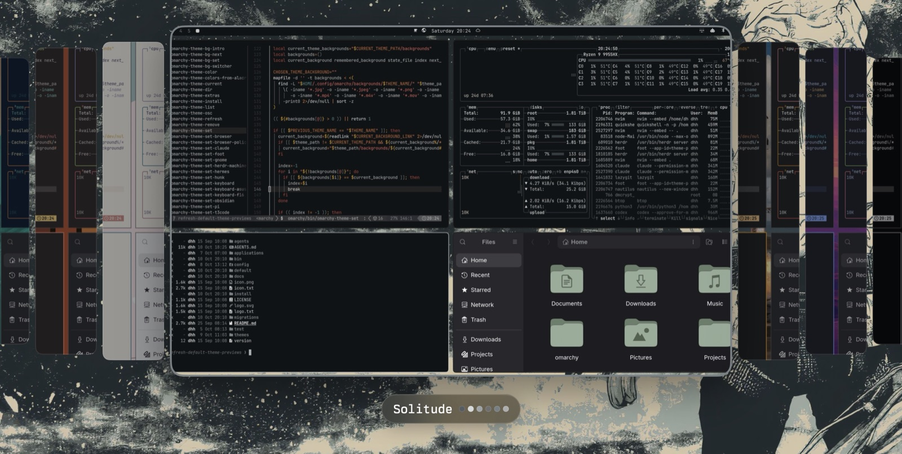
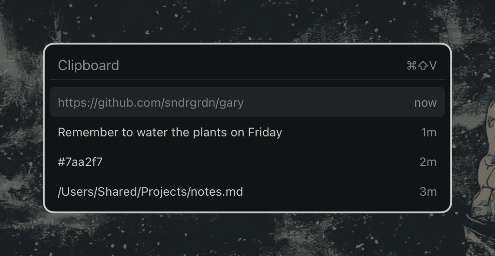
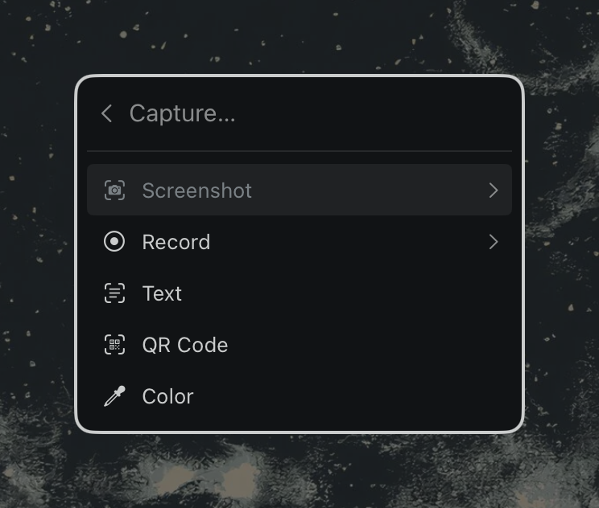
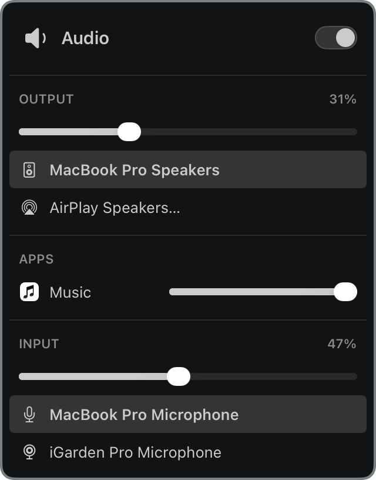
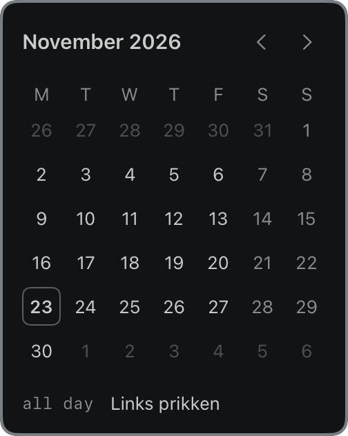
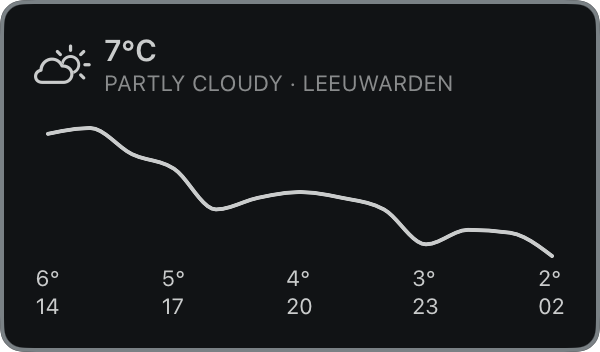
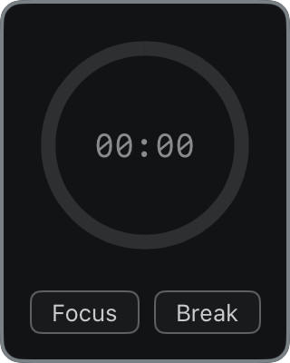

# Gary

> meow.

A macOS shell you write in TypeScript. Or that your agent writes for you.

```sh
curl -fsSL https://raw.githubusercontent.com/sndrgrdn/gary/main/scripts/install.sh | sh
```




Gary draws a bar along the top of each display, plus panels, overlays, menus, and background services. Every pixel of it comes from a plugin: one you wrote, one you installed, or one you asked an agent for five minutes ago. The screenshots show [sndrgrdn/gary-plugins](https://github.com/sndrgrdn/gary-plugins), an Omarchy-style desktop built on Gary.

Gary needs macOS 27.2 or later on Apple silicon.

## Hand it to your agent

Paste this into Claude Code, Codex, pi, or another coding agent. It installs Gary, learns how to write plugins, and builds the setup you ask for.

```text
Set up Gary, the macOS shell from https://github.com/sndrgrdn/gary, on this Mac.

1. Check that this Mac runs macOS 27.2 or later on Apple silicon with `sw_vers -productVersion` and `uname -m`. If it does not, stop and tell me.
2. If `gary --version` fails, install Gary. Ask me whether I prefer Homebrew. With Homebrew, run `brew install --cask sndrgrdn/tap/gary`, then `gary login on` and `open -a Gary`. Otherwise run `curl -fsSL https://raw.githubusercontent.com/sndrgrdn/gary/main/scripts/install.sh | sh`.
3. Run `gary ping` and check that it prints `pong`.
4. Run `gary skill setup`, then run `gary skill show`. Follow the guide it prints for every step after this one.
5. Ask me what I want Gary to show, such as a bar with the time, battery, Wi-Fi, and audio, a launcher, or a clipboard history. Offer the plugins in https://github.com/sndrgrdn/gary-plugins as a starting point, and install them with `gary plugin install git:github.com/sndrgrdn/gary-plugins` only if I agree.
6. Build each plugin I ask for in ~/.config/gary/plugins, starting from the closest bundled example. Test each one with the gary commands that the guide lists.
7. Run `gary permissions` and tell me which macOS permissions my plugins need and why. Then run `gary onboarding` so that I can grant them.
8. Tell me what Gary now shows, and what you could not check.
```

Agents are first-class here. The `gary` command clicks, types, hovers, and scrolls in a plugin, prints its node tree, and captures it as a PNG, so your agent sees what it built instead of guessing. `gary skill setup` installs a small skill into `~/.claude/skills` and `~/.agents/skills`, and `gary skill show` prints the guide for the exact version you run.

## What it looks like

Everything below is a plugin from [sndrgrdn/gary-plugins](https://github.com/sndrgrdn/gary-plugins), installable with one command.

<p>
  
  
</p>

<p>
  
  
  
</p>

<p>
  
  
  
</p>

There is more: Wi-Fi and Bluetooth panels, a fuzzy app launcher that also does calculations and conversions, a Hyper key, an on-screen display for volume and brightness, a drawer for other apps' menu bar icons, and the workspaces of the [dinky](https://github.com/mikker/dinky) window manager.

## Why Gary

- **Save, and it's there.** Gary reloads a plugin about 40 ms after you save. A broken version logs its error and the working one keeps running.
- **No build step.** Write `.ts` and `.tsx` with JSX. Gary compiles them itself.
- **Types that know your manifest.** `gary plugin types` writes declarations for exactly the capabilities a plugin asks for, so `tsc` catches the field you misspelled.
- **The whole Mac, one import away.** Audio, battery, Bluetooth, brightness, calendar, clipboard, Wi-Fi, now playing, notifications, screen capture, text recognition, global hotkeys, a Hyper key, the menu bar tray, and more. Gary asks for a macOS permission only when an enabled plugin needs it.
- **More than a bar.** Bar widgets, whole bars, panels, overlays, keyboard-driven menus, and headless services. Draw with gradients, animated shapes, charts, grids, blur, and Metal shaders.
- **Plugins can't take the shell down.** Each plugin kind runs in its own JavaScriptCore context. A handler that burns more than 100 ms of CPU gets stopped and its plugin restarted.
- **Effect built in.** Import [Effect](https://effect.website) from `gary:effect` for services, schedules, `fetch`, and streams. Plugins that don't import it don't pay for it.
- **Themes.** A `palette.toml` in the format of an Omarchy theme's `colors.toml`, and a `theme.json` of styles, fonts, spacing, and corner radii that every plugin follows.
- **Packages.** Install plugins from git, npm, or a folder, and keep them current with `gary plugin update`.

## Do it yourself

1. Install Gary with the command at the top. It installs `~/Applications/Gary.app`, links `~/.local/bin/gary`, starts Gary at login, and starts it now. [Install Gary](docs/install.md) covers Homebrew, building from source, updating, and uninstalling.

2. Make a plugin:

   ```sh
   gary plugin new you.hello
   ```

   Gary writes `~/.config/gary/plugins/you.hello` and puts it in the bar. Edit `widget.ts`, save, and watch the bar change.

3. Steal an [example](examples), like an app launcher on Control-Option-Space:

   ```sh
   gary plugin new you.launcher --from launcher
   ```

   Or install a whole desktop. Several of these plugins draw Nerd Font icons, and their READMEs say which font they need:

   ```sh
   gary plugin install git:github.com/sndrgrdn/gary-plugins
   ```

4. Grant the permissions your plugins need:

   ```sh
   gary onboarding
   ```

   The **Set up Gary** window lists each permission an enabled plugin needs, each with an **Allow** button. Gary also opens it on first launch, and whenever a newly enabled plugin needs something new.

A plugin is a folder with a `manifest.json` and one entry file per kind. Here is a whole battery widget, with `"subscribes": ["battery"]` in its manifest:

```tsx
export default {
  render(state) {
    return (
      <row gap={4}>
        <icon symbol={state.battery?.charging ? "bolt.fill" : "battery.75percent"} style="dim" />
        <text>{state.battery?.percent ?? "–"}%</text>
      </row>
    );
  },
} satisfies Gary.BarWidget;
```

## Examples

Copy any of these with `gary plugin new you.<name> --from <example>`.

- [`launcher`](examples/launcher): a keyboard-driven app launcher on a global hotkey.
- [`osd`](examples/osd): a volume slider panel and an on-screen volume display, from one module.
- [`gallery`](examples/gallery): gradients, an animated progress ring, sparklines, a calendar grid, and a Metal shader.
- [`weather`](examples/weather): the temperature from Open-Meteo, fetched and decoded with Effect.
- [`popover`](examples/popover): a bar widget with a panel attached below it, and every kind of click and scroll.
- [`timer`](examples/timer): a countdown that keeps running while its panel is hidden.
- [`disk`](examples/disk): a service and a widget in one plugin, talking over a typed topic.
- [`shortcuts`](examples/shortcuts): global shortcuts that open apps, read from settings.
- [`load`](examples/load) and [`today`](examples/today): small starters without Effect.

## Documentation

| Guide                                                | Covers                                                                                 |
| ---------------------------------------------------- | -------------------------------------------------------------------------------------- |
| [Install Gary](docs/install.md)                      | The install script, Homebrew, building from source, permissions, updates, and removal. |
| [Write plugins](docs/plugins.md)                     | Plugin kinds, surfaces, topics, entry files, layout, Effect, and settings.             |
| [Test plugins](docs/testing.md)                      | Driving and inspecting a plugin with the `gary` command, and reading the log.          |
| [Capabilities and permissions](docs/capabilities.md) | What each capability gives a plugin, and the macOS permission it needs.                |
| [Configure the shell](docs/configuration.md)         | `shell.json`: the bar's sections, enabled plugins, plugin settings, and packages.      |
| [Themes](docs/themes.md)                             | `palette.toml` and `theme.json`: colors, styles, fonts, spacing, and the bar.          |
| [Packages](docs/packages.md)                         | Installing, updating, and publishing plugins from git, npm, or a folder.               |
| [Develop Gary](docs/development.md)                  | Building, testing, and releasing Gary itself.                                          |

`gary help` lists every command. `gary skill show <topic>` prints the full reference for your version, such as `gary skill show manifest` or `gary skill show audio`.

## License

MIT. Gary includes [mediaremote-adapter](https://github.com/ungive/mediaremote-adapter) under the [BSD 3-Clause License](Vendor/mediaremote-adapter/LICENSE).
