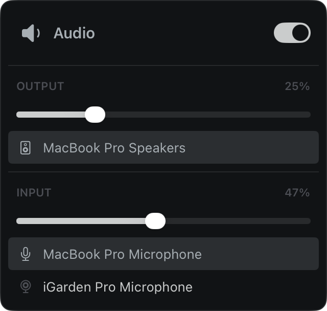
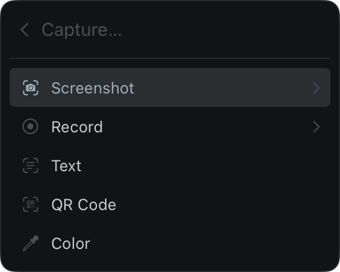

# Gary

Gary is a macOS shell that you build from TypeScript plugins. It draws a bar along the top of each display, and panels, overlays, menus, and background services, from plugins that you write, install, or ask an agent to write for you.


<p>
  
  
</p>

The screenshots show [sndrgrdn/gary-plugins](https://github.com/sndrgrdn/gary-plugins), an Omarchy-style desktop built on Gary.

## Features

- **Six plugin kinds.** Bar widgets, whole bars, panels, overlays, keyboard-driven menus, and services without a view.
- **TypeScript and JSX without a build step.** Gary compiles `.ts` and `.tsx` files itself. `gary plugin types` writes declarations for exactly the capabilities that a plugin's manifest asks for, so `tsc` checks every field.
- **Capabilities for the whole Mac.** Audio, battery, Bluetooth, brightness, calendar, clipboard, Wi-Fi, now playing, notifications, screen capture, text recognition, global hotkeys, a Hyper key, the menu bar tray, and more. Gary asks for a macOS permission only when an enabled plugin needs it.
- **Live reload.** Save a file and Gary reloads the plugin in about 40 ms. A version that fails logs its error and leaves the running version in place.
- **Isolation.** Each plugin kind runs in its own JavaScriptCore context. Gary stops a handler that runs longer than 100 ms of CPU time, and restarts the plugin.
- **Effect built in.** Import [Effect](https://effect.website) from `gary:effect` for services, timers, `fetch`, and streams. Only plugins that import it load it.
- **Themes.** A `palette.toml` of colors, in the format of an Omarchy theme's `colors.toml`, and a `theme.json` of styles, fonts, spacing, and corner radii that every plugin follows.
- **Packages.** Install plugins from git, npm, or a local folder, and keep them up to date with `gary plugin update`.
- **Made for agents.** The `gary` command clicks, types, hovers, and scrolls in a plugin, prints its node tree, and captures it as a PNG, so an agent can test what it builds. `gary skill setup` teaches your coding agent how.

## Requirements

Gary needs macOS 27.2 or later on Apple silicon.

## Quick start

1. Install Gary:

   ```sh
   curl -fsSL https://raw.githubusercontent.com/sndrgrdn/gary/main/scripts/install.sh | sh
   ```

   The script installs `~/Applications/Gary.app`, links `~/.local/bin/gary`, starts Gary at login, and starts it now. A bar with a clock and the battery level appears at the top of each display. [Install Gary](docs/install.md) covers Homebrew, building from source, updating, and uninstalling.

2. Create your first plugin:

   ```sh
   gary plugin new you.hello
   ```

   Gary writes `~/.config/gary/plugins/you.hello` and adds the widget to the right of the bar. Edit `widget.ts` and save it. The bar shows your change at once.

3. Copy one of the [examples](examples), such as an app launcher on Control-Option-Space:

   ```sh
   gary plugin new you.launcher --from launcher
   ```

   Or install a whole desktop of ready-made plugins. Several of them draw Nerd Font icons, and their READMEs say which font they need:

   ```sh
   gary plugin install git:github.com/sndrgrdn/gary-plugins
   ```

4. Grant the macOS permissions that your plugins need:

   ```sh
   gary onboarding
   ```

   The **Set up Gary** window lists each permission that an enabled plugin needs, with an **Allow** button for each. Gary also opens it on first launch, and when a newly enabled plugin needs a permission.

A plugin is a folder with a `manifest.json` and one entry file per kind. This bar widget shows the battery level, with `"subscribes": ["battery"]` in its manifest:

```tsx
export default {
  render(state) {
    return (
      <row gap={4}>
        <icon symbol={state.battery?.charging ? "bolt.fill" : "battery.75percent"} style="dim" />
        <text>{state.battery?.percent ?? "–"}%</text>
      </row>
    );
  },
} satisfies Gary.BarWidget;
```

## For agents

Copy this prompt into Claude Code, Codex, pi, or another coding agent. The agent installs Gary, learns how to write plugins for it, and builds the setup you ask for.

```text
Set up Gary, the macOS shell from https://github.com/sndrgrdn/gary, on this Mac.

1. Check that this Mac runs macOS 27.2 or later on Apple silicon with `sw_vers -productVersion` and `uname -m`. If it does not, stop and tell me.
2. If `gary --version` fails, install Gary. Ask me whether I prefer Homebrew. With Homebrew, run `brew install --cask sndrgrdn/tap/gary`, then `gary login on` and `open -a Gary`. Otherwise run `curl -fsSL https://raw.githubusercontent.com/sndrgrdn/gary/main/scripts/install.sh | sh`.
3. Run `gary ping` and check that it prints `pong`.
4. Run `gary skill setup`, then run `gary skill show`. Follow the guide it prints for every step after this one.
5. Ask me what I want Gary to show, such as a bar with the time, battery, Wi-Fi, and audio, a launcher, or a clipboard history. Offer the plugins in https://github.com/sndrgrdn/gary-plugins as a starting point, and install them with `gary plugin install git:github.com/sndrgrdn/gary-plugins` only if I agree.
6. Build each plugin I ask for in ~/.config/gary/plugins, starting from the closest bundled example. Test each one with the gary commands that the guide lists.
7. Run `gary permissions` and tell me which macOS permissions my plugins need and why. Then run `gary onboarding` so that I can grant them.
8. Tell me what Gary now shows, and what you could not check.
```

`gary skill setup` installs a small skill into `~/.claude/skills` and `~/.agents/skills`, which Codex, OpenCode, and pi read. The skill tells the agent to run `gary skill show`, which prints the guide for the installed version of Gary.

## Documentation

| Guide                                                | Covers                                                                                 |
| ---------------------------------------------------- | -------------------------------------------------------------------------------------- |
| [Install Gary](docs/install.md)                      | The install script, Homebrew, building from source, permissions, updates, and removal. |
| [Write plugins](docs/plugins.md)                     | Plugin kinds, surfaces, topics, entry files, layout, Effect, and settings.             |
| [Test plugins](docs/testing.md)                      | Driving and inspecting a plugin with the `gary` command, and reading the log.          |
| [Capabilities and permissions](docs/capabilities.md) | What each capability gives a plugin, and the macOS permission it needs.                |
| [Configure the shell](docs/configuration.md)         | `shell.json`: the bar's sections, enabled plugins, plugin settings, and packages.      |
| [Themes](docs/themes.md)                             | `palette.toml` and `theme.json`: colors, styles, fonts, spacing, and the bar.          |
| [Packages](docs/packages.md)                         | Installing, updating, and publishing plugins from git, npm, or a folder.               |
| [Develop Gary](docs/development.md)                  | Building, testing, and releasing Gary itself.                                          |

`gary help` lists every command. `gary skill show <topic>` prints the full reference that ships with your version, such as `gary skill show manifest` or `gary skill show audio`.

## License

Gary is released under the [MIT License](LICENSE). It includes [mediaremote-adapter](https://github.com/ungive/mediaremote-adapter) under the [BSD 3-Clause License](Vendor/mediaremote-adapter/LICENSE).
